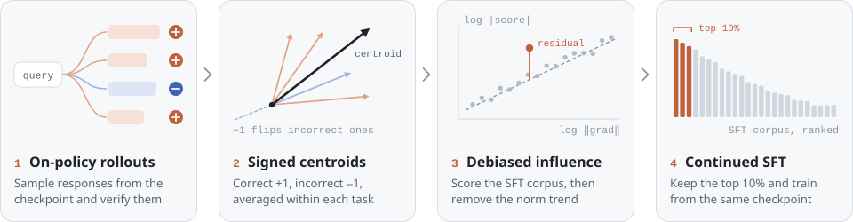

<div align="center">

# DRIFT

**Data Selection for LLM Instruction Tuning via On-Policy Attribution**

[](https://arxiv.org/abs/2606.18307)
[](https://github.com/ZefanW/DRIFT/actions/workflows/tests.yml)
[](pyproject.toml)
[](LICENSE)

[Paper](https://arxiv.org/abs/2606.18307) · [Results](#results) · [Quick start](#quick-start) · [Run on your data](#run-drift-on-your-data) · [Docs](#documentation) · [Citation](#citation)

<sub>Zefan Wang, Lincheng Li, Tianyu Yu, Yuan Yao · Tsinghua University</sub>

</div>

Data selection for instruction tuning is usually studied for efficiency. DRIFT studies whether selection can also raise the ceiling and produce a better model than training on the full corpus.

DRIFT starts from a model that has already finished SFT on all of its data. It samples the model's own responses to a set of validation queries, labels each response as correct or incorrect, and ranks the original SFT corpus by its influence on those signed responses. Continuing SFT on the top 10% improves Olmo3-7B-Instruct-SFT and OpenR1-Distill-7B over their full-data checkpoints and outperforms every selection baseline we evaluated.

<p align="center">
  <picture>
    <source media="(prefers-color-scheme: dark)" srcset="assets/overview-dark.svg">
    
  </picture>
</p>

## Method

Influence functions are a local approximation, so they are most reliable when the validation target lies close to the current parameters. A model's own responses are much closer targets than external reference answers. DRIFT attributes on those responses and signs them by correctness.

1. **On-policy rollouts.** Sample several responses to each validation query from the checkpoint and verify them. Reference answers are used only for grading.
2. **Signed validation centroids.** Take the token-mean CE gradient of each response over its assistant tokens and compress it with a [GraSS](https://arxiv.org/abs/2505.18976) sparse projection. Average the gradients within each validation task, weighting correct responses by `+1` and incorrect ones by `−1`.
3. **Debiased influence.** Score every corpus example by its dot product with each task centroid. Within each task, fit a power law between score magnitude and gradient norm, remove the fitted norm component, and keep the sign. Sum the corrected scores over tasks.
4. **Continued SFT.** Keep the top 10% of the corpus and continue training from the same checkpoint.

## Results

Accuracy (%) after continuing SFT from each model's full-data checkpoint on 10% of its original corpus, as reported in the [paper](https://arxiv.org/abs/2606.18307) (v2, Table 1). **All** averages eight benchmarks. **Add.** averages the four benchmarks that supply no validation queries.

<table>
  <thead>
    <tr>
      <th rowspan="2" align="left">Selection method</th>
      <th colspan="2" align="center">Olmo3-7B-Instruct-SFT</th>
      <th colspan="2" align="center">OpenR1-Distill-7B</th>
    </tr>
    <tr>
      <th align="right">All</th><th align="right">Add.</th>
      <th align="right">All</th><th align="right">Add.</th>
    </tr>
  </thead>
  <tbody>
    <tr><td><i>Full-data checkpoint</i></td><td align="right"><i>39.17</i></td><td align="right"><i>25.49</i></td><td align="right"><i>57.23</i></td><td align="right"><i>46.24</i></td></tr>
    <tr><td>Random</td><td align="right">39.04</td><td align="right">25.21</td><td align="right">57.40</td><td align="right">46.65</td></tr>
    <tr><td>DSIR</td><td align="right">34.37</td><td align="right">22.76</td><td align="right">56.24</td><td align="right">45.43</td></tr>
    <tr><td>QuRating</td><td align="right">39.26</td><td align="right">25.71</td><td align="right">57.78</td><td align="right">47.05</td></tr>
    <tr><td>BM25</td><td align="right">39.54</td><td align="right">25.92</td><td align="right">57.32</td><td align="right">46.54</td></tr>
    <tr><td>LESS</td><td align="right">37.63</td><td align="right">23.96</td><td align="right">57.28</td><td align="right">46.44</td></tr>
    <tr><td>RDS</td><td align="right">39.08</td><td align="right">25.50</td><td align="right">57.63</td><td align="right">46.91</td></tr>
    <tr><td>IF with reference answers (GraSS)</td><td align="right">38.66</td><td align="right">24.80</td><td align="right">57.85</td><td align="right">47.69</td></tr>
    <tr><td><b>DRIFT</b></td><td align="right"><b>40.14</b></td><td align="right"><b>26.51</b></td><td align="right"><b>58.66</b></td><td align="right"><b>48.73</b></td></tr>
  </tbody>
</table>

The validation-source benchmarks are BBH, MBPP+, MATH and MMLU-Pro. The additional ones are ZebraLogic, LiveCodeBench v5, OlympiadBench and GPQA Diamond. Olmo3 numbers are means over three training seeds. Per-benchmark results and ablations are in the paper.

This repository is a self-contained reimplementation of the method. The paper's runs projected gradients with dattri, and the NumPy projection here draws a different random matrix, so the same seed does not reproduce the paper's exact subset. [Reproducibility](docs/reproducibility.md) lists the differences.

## Quick start

### CPU check, no model download

The NumPy core and the tests need only Python 3.10+.

```bash
git clone https://github.com/ZefanW/DRIFT.git
cd DRIFT
python -m venv .venv
source .venv/bin/activate
python -m pip install -e '.[dev]'

drift demo --output runs/cpu-demo
python -m pytest
```

The demo scores synthetic features. The files in [`examples/`](examples/) are small fixtures.

### Real-model smoke check

Use a separate Linux GPU environment with Python 3.12 and a PyTorch build that matches your CUDA version. The model, its gradients and its activations must fit on each selected GPU.

```bash
python3.12 -m venv .venv-gpu
source .venv-gpu/bin/activate
python -m pip install -e '.[models]'

python scripts/run_method.py --config configs/smoke.json \
  --model allenai/OLMo-2-0425-1B-SFT \
  --corpus examples/corpus.jsonl --queries examples/queries.jsonl \
  --output runs/model-smoke --gpus 0
```

This runs the whole selection pipeline on 13 corpus examples and 2 validation queries and writes `runs/model-smoke/selection/subset.jsonl`. A local model snapshot can replace the Hub ID. Each run needs a fresh output directory.

## Run DRIFT on your data

Prepare your original SFT corpus and validation queries in the [input formats](docs/pipeline.md#input-formats), then preview the pipeline.

```bash
python scripts/run_method.py --config configs/olmo3.json \
  --model ./models/my-sft-checkpoint \
  --corpus ./data/corpus.jsonl --queries ./data/queries.jsonl \
  --output runs/my-drift --gpus 0,1 --backend transformers --dry-run
```

Remove `--dry-run` to execute. Each GPU runs an independent model replica. The runner moves to the next stage only after the current one succeeds, keeps one log per process, and stops sibling processes if a rank fails. Completed outputs are never overwritten, and partial stages are not resumed.

| Configuration | Checkpoint | Rollouts per query | Projection | Selection | Use |
|---|---|---:|---:|---:|---|
| [`olmo3.json`](configs/olmo3.json) | `allenai/Olmo-3-7B-Instruct-SFT` | 32 | 16,384 | 10% | Paper's Olmo3 settings |
| [`olmo2_1b.json`](configs/olmo2_1b.json) | `allenai/OLMo-2-0425-1B-SFT` | 16 | 16,384 | 10% | Small model for cheap trials |
| [`smoke.json`](configs/smoke.json) | set with `--model` | 2 | 128 | 20% | Plumbing check on the fixtures |

Copy a configuration to pin your model revision and settings, and use the same frozen checkpoint and tokenizer for rollout and both gradient-extraction passes. The paper's Olmo3 run selects from [Dolci-Instruct-SFT](https://huggingface.co/datasets/allenai/Dolci-Instruct-SFT-No-Tools) with validation queries drawn from MATH, MBPP, BBH and MMLU-Pro. Its OpenR1 run uses 8 rollouts per query and excludes the embedding layer through `exclude_parameters`.

Optional installs:

- `python -m pip install -e '.[data]'` for Parquet inputs.
- `python -m pip install -e '.[math]'` for mathematical answer verification.
- `python -m pip install -e '.[rollout]'` for vLLM generation. Use a separate environment, since vLLM pins its own PyTorch.

Built-in verifiers cover multiple-choice labels, exact answers and mathematical equivalence. Code tasks and benchmark-specific graders supply signed rewards through `--external-labels`. In that case run `prepare` and `rollout`, grade the generated responses, then run `label`, `extract`, `score` and `select` as separate stages. See the [stage-by-stage commands](docs/pipeline.md) and the [reward contract](docs/reproducibility.md#verifiers-and-external-rewards).

`--fit-mode stable` (default) is the OLS fit described in the paper. `legacy-float32` replays the numerical convention of the paper's original runs. The two modes can give different slopes and selections.

### Continue SFT

Install the [pinned training environment](docs/reproducibility.md#continual-sft-and-outcome-evaluation), then run:

```bash
python scripts/continue_sft.py --model ./models/my-sft-checkpoint \
  --dataset runs/my-drift/selection/subset.jsonl \
  --output runs/my-drift/continued-sft --gpus 0,1,2,3 \
  --max-steps 500 --max-length 32768 --global-sequences 8 --dry-run
```

Remove `--dry-run` to train. The defaults follow the paper's Olmo3 recipe, with full-parameter BF16 training, packed 32,768-token sequences and eight sequences per update. Packing needs a compatible FlashAttention build, and multi-GPU training uses DeepSpeed ZeRO-2. The bundled `drift_chat` template plugin for [ms-swift](https://github.com/modelscope/ms-swift) reuses the checkpoint's chat template and the attribution loss mask.

### Cost

Wall-clock time for Olmo3-7B-Instruct-SFT and its 2M-example corpus on one node with eight A800 GPUs, as reported in the paper (Table 12).

| Stage | Time | Reusable |
|---|---:|---|
| Corpus gradient extraction and projection (63 GB of features) | 12&nbsp;h | Yes, for a fixed checkpoint, corpus and projection |
| 32 rollouts per validation query | 8&nbsp;h | No, repeated for each validation set |
| Validation gradients and scoring | <&nbsp;0.5&nbsp;h | No |
| Continued SFT, 500 steps | 6.6&nbsp;h | No |

Generation time scales with the number of rollouts. The paper's rollout-budget ablation (Table 2) reports the accuracy at smaller budgets.

## Release status

- [x] Selection pipeline with rollout, verification, gradient extraction, scoring and subset export
- [x] Continued-SFT entry point
- [ ] Identifiers of the selected top-10% subsets
- [ ] Validation rollouts with correctness labels
- [ ] Per-seed evaluation results

The unchecked items are the remaining artifacts listed in the paper's reproducibility statement.

## Documentation

| Document | Contents |
|---|---|
| [Pipeline](docs/pipeline.md) | Stage-by-stage commands, input formats and verifiers |
| [Reproducibility](docs/reproducibility.md) | Numerical definitions, artifact contracts, multi-GPU extraction and the training recipe |
| [Validation](docs/validation.md) | Checks run for this release and their environments |

<details>
<summary>Repository layout</summary>

| Path | Contents |
|---|---|
| [`src/drift/`](src/drift/) | Generation, verification, masking, projection, extraction, scoring and the CLI |
| [`scripts/`](scripts/) | Pipeline runner, SFT wrapper and ms-swift template plugin |
| [`configs/`](configs/) | Olmo3, OLMo2 and smoke configurations |
| [`examples/`](examples/) | Small corpus, queries and saved-response fixtures |
| [`tests/`](tests/) | CPU correctness and orchestration tests |
| [`docs/`](docs/) | Commands, reproducibility contracts and the validation record |
| [`requirements-train.txt`](requirements-train.txt) | Pinned continued-SFT dependencies |

</details>

## Citation

```bibtex
@misc{wang2026drift,
  title         = {{DRIFT}: Data Selection for {LLM} Instruction Tuning via On-Policy Attribution},
  author        = {Wang, Zefan and Li, Lincheng and Yu, Tianyu and Yao, Yuan},
  year          = {2026},
  eprint        = {2606.18307},
  archivePrefix = {arXiv},
  primaryClass  = {cs.LG},
  url           = {https://arxiv.org/abs/2606.18307}
}
```

This repository follows arXiv v2 (September 2026). The first version (June 2026) was titled *DRIFT: Refining Instruction Data via On-Policy Data Attribution*.

## Acknowledgements

Gradient projection follows [GraSS](https://arxiv.org/abs/2505.18976). Generation uses [vLLM](https://github.com/vllm-project/vllm) or Transformers, and continued SFT uses [ms-swift](https://github.com/modelscope/ms-swift).

## License

Code is released under the [MIT License](LICENSE). Model, dataset and dependency licenses apply separately.
