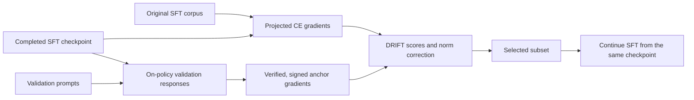

# DRIFT

**Data Selection for LLM Instruction Tuning via On-Policy Attribution**

Zefan Wang · Lincheng Li · Tianyu Yu · Yuan Yao

[](LICENSE)

DRIFT selects instruction-tuning examples using a model’s own validation responses. Starting from a **checkpoint that has completed SFT**, it verifies sampled responses, attributes their outcomes to the original SFT corpus through projected gradients, corrects score dependence on gradient norm, and selects a subset for continued SFT from the same checkpoint.

[Quick start](#quick-start) · [Full pipeline](docs/pipeline.md) · [Reproducibility](docs/reproducibility.md) · [Validation](docs/validation.md) · [Citation](#citation)

## Method



1. **Sample and verify.** Generate validation responses and assign correctness rewards of `+1` or `−1`. Reference answers are used for verification, never substituted for generated responses.
2. **Attribute.** Compute assistant-token CE gradients, project them with a sparse GraSS sketch, and construct reward-weighted task centroids with equal query weighting.
3. **Select.** Score corpus examples against each task centroid, apply task-specific power-law norm correction, sum scores, and export the highest-scoring fraction (10% by default).
4. **Continue SFT.** Train on the selected original conversations from the same SFT checkpoint.

The package includes generation with Transformers or vLLM, built-in and external reward verification, gradient extraction, multi-GPU sharding, scoring, subset export, and a continuation-training entry point. It preserves multi-turn conversations and records input hashes, projection settings, and fit diagnostics.

## Quick start

### CPU check — no model download

Python 3.10+ is sufficient for the NumPy core and tests.

```bash
git clone https://github.com/ZefanW/DRIFT.git
cd DRIFT
python -m venv .venv
source .venv/bin/activate
python -m pip install -e '.[dev]'

drift demo --output runs/cpu-demo
python -m pytest
```

The demo uses synthetic features. The small files in [`examples/`](examples/) are fixtures, not benchmark results.

### Real-model smoke check

Use a separate **Linux/NVIDIA GPU environment with Python 3.12**. The model, its gradients, and activations must fit on each selected GPU; the verified hardware was an A800 80 GB. Install a PyTorch build compatible with your CUDA environment.

```bash
python3.12 -m venv .venv-gpu
source .venv-gpu/bin/activate
python -m pip install -e '.[models]'

python scripts/run_method.py --config configs/smoke.json \
  --model allenai/OLMo-2-0425-1B-SFT \
  --corpus examples/corpus.jsonl --queries examples/queries.jsonl \
  --output runs/model-smoke --gpus 0
```

This runs the complete selection pipeline on 13 corpus examples and 2 validation queries, with 2 responses per query and 128-dimensional features. The output is `runs/model-smoke/selection/subset.jsonl`. A local immutable model snapshot can replace the Hub model ID. Each run requires a fresh output directory.

## Run DRIFT on your data

Prepare your original SFT corpus and validation prompts using the [input schema](docs/pipeline.md#input-formats), then preview the configured pipeline:

```bash
python scripts/run_method.py --config configs/olmo3.json \
  --model ./models/my-sft-checkpoint \
  --corpus ./data/corpus.jsonl --queries ./data/queries.jsonl \
  --output runs/my-drift --gpus 0,1 --backend transformers --dry-run
```

Remove `--dry-run` to execute. Each GPU runs an independent model replica. The runner advances only after a stage succeeds, records per-rank logs, and stops its own sibling processes if a rank fails. Completed outputs are never overwritten; partial stages are not automatically resumed.

| Configuration | Starting checkpoint | Responses/query | Projection | Selection |
|---|---|---:|---:|---:|
| [`olmo3.json`](configs/olmo3.json) | OLMo3 7B Instruct SFT | 32 | 16,384 | 10% |
| [`olmo2_1b.json`](configs/olmo2_1b.json) | OLMo2 1B SFT | 16 | 16,384 | 10% |
| [`smoke.json`](configs/smoke.json) | User-selected via `--model` | 2 | 128 | 20% |

The configurations describe method settings, not additional benchmark claims. Copy a configuration to pin your model revision and settings. Use the same frozen checkpoint and tokenizer for rollout and both gradient-extraction passes.

Optional installations:

- `python -m pip install -e '.[data]'` — Parquet inputs.
- `python -m pip install -e '.[math]'` — mathematical answer verification.
- `python -m pip install -e '.[rollout]'` — vLLM generation. Install this in a compatible environment; vLLM pins its own PyTorch requirements.

Built-in verifiers support multiple-choice labels, exact answers, and mathematical equivalence. Code tasks or benchmark-specific graders can supply signed rewards through `--external-labels`. Run `prepare` and `rollout`, evaluate the generated responses, then run `label`, `extract`, `score`, and `select` as separate stages. See the [complete commands](docs/pipeline.md) and [reward contract](docs/reproducibility.md#verifiers-and-external-rewards).

### Continue SFT

Install the [pinned training environment](docs/reproducibility.md#continual-sft-and-outcome-evaluation), then run:

```bash
python scripts/continue_sft.py --model ./models/my-sft-checkpoint \
  --dataset runs/my-drift/selection/subset.jsonl \
  --output runs/my-drift/continued-sft --gpus 0,1,2,3 \
  --max-steps 500 --max-length 32768 --global-sequences 8 --dry-run
```

Remove `--dry-run` to train. This recipe uses full-parameter BF16 training, packed sequences, and a global batch of eight sequences; gradient accumulation adjusts to the GPU count. Packing requires compatible FlashAttention, and multi-GPU training uses DeepSpeed ZeRO-2. The bundled `drift_chat` plugin reuses the checkpoint’s chat template and the attribution loss mask. Small SDPA training checks are documented [here](docs/reproducibility.md#continual-sft-and-outcome-evaluation).

## Reproducibility and validation

This release provides the method implementation. Historical checkpoints, frozen rollouts, and benchmark-result artifacts are not bundled. The portable projection and numerical modes are documented explicitly; the same seed does not promise the historical selected subset.

- `stable` (default): centered float64 OLS with an intercept.
- `legacy-float32`: the earlier float32-input fitting convention, with numerical-rank diagnostics.

These modes can produce different slopes and selections. Clipping and z-scoring are opt-in. See [numerical definitions and artifact checks](docs/reproducibility.md) before comparing runs.

The release passed 111 CPU tests and small real-model selection checks on OLMo2 1B and OLMo3 7B. Both generation backends were exercised; the continuation entry point completed two optimizer steps and saved a checkpoint. These are execution checks, not paper-scale quality measurements. See [the validation record](docs/validation.md) for environments and scope.

An optional [GitHub Actions workflow template](docs/ci.example.yml) is provided for Python 3.10 and 3.12. See [CI setup](docs/ci.md) to enable it.

## Repository layout

| Path | Contents |
|---|---|
| [`src/drift/`](src/drift/) | Generation, verification, masking, projection, extraction, scoring, and CLI |
| [`scripts/`](scripts/) | Pipeline runner, SFT wrapper, and Swift template plugin |
| [`configs/`](configs/) | OLMo3, OLMo2, and smoke configurations |
| [`examples/`](examples/) | Small corpus, queries, and saved-response fixtures |
| [`tests/`](tests/) | CPU correctness and orchestration tests |
| [`docs/`](docs/) | Full commands, reproducibility contracts, and validation record |
| [`requirements-train.txt`](requirements-train.txt) | Pinned continuation-training dependencies |

## Citation

Citation metadata is available in [`CITATION.cff`](CITATION.cff). To reference this implementation:

```bibtex
@software{wang2026drift,
  author  = {Wang, Zefan and Li, Lincheng and Yu, Tianyu and Yao, Yuan},
  title   = {DRIFT: Data Selection for LLM Instruction Tuning via On-Policy Attribution},
  year    = {2026},
  version = {0.1.0},
  url     = {https://github.com/ZefanW/DRIFT}
}
```

## License

[MIT](LICENSE). Model, dataset, and dependency licenses apply separately.
